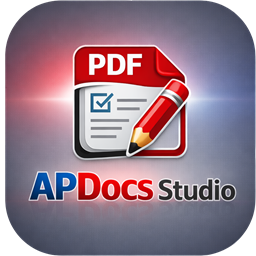
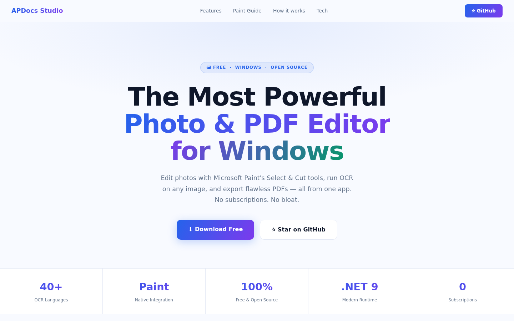

<div align="center">



# APDocs Studio

A free photo and PDF editor for Windows. Fix images, pull text out with OCR, and export clean PDFs, with Microsoft Paint wired in for quick cut-and-select edits.

[Website](https://apdocsstudio.netlify.app) | [Download v1.0.0](https://github.com/atharvpawar16/APDocsStudio/releases/tag/v1.0.0) | [Wiki](https://github.com/atharvpawar16/APDocsStudio/wiki)

[](https://github.com/atharvpawar16/APDocsStudio/actions/workflows/ci.yml) [](https://github.com/atharvpawar16/APDocsStudio/releases/latest)

</div>



## What it is

APDocs Studio is a desktop app for scanning, editing and exporting documents. It runs on your own machine. No account, no subscription, nothing is uploaded.

It is a fork of [NAPS2](https://github.com/cyanfish/naps2) (see the credit section below). What I added on top is the Paint integration, the APDocs Studio branding and the project website.

## Features

**Photo editing:** brightness and contrast, saturation and hue, sharpness, crop and rotate, auto deskew, black and white, and blank page detection for batches.

**PDF tools:** open an existing PDF and edit it page by page, export a normal or searchable PDF, merge images into one PDF, drag pages into a new order, and choose the balance between file size and image quality.

**OCR:** text extraction with Tesseract in 40+ languages. The text can be embedded in the PDF as an invisible layer, so the file is searchable and copyable.

**Paint integration:** open any page in Microsoft Paint, use its Select and Cut tools, save, and the change shows up back in APDocs Studio.

## Using Paint

Paint comes with Windows. Right-click a page and choose Edit with Paint.

### Rectangular Select & Cut
```
1. Right-click a page in APDocs Studio → Edit with Paint
2. In Paint's Home tab, click Select → Rectangular selection
3. Draw a box around the area you want to remove
4. Press Delete or Ctrl+X to cut it out (fills with white)
5. Press Ctrl+S to save — APDocs Studio reloads it instantly
```

### Free-form Select
```
1. Click Select → Free-form selection
2. Draw around the exact shape you want to keep
3. Ctrl+C → Ctrl+N → Ctrl+V to paste onto a clean canvas
4. Save → export as PDF from APDocs Studio
```

### Remove a Watermark or Stamp
```
1. Right-click Color 2 in Paint → set to white
2. Use Rectangular Select to box the watermark
3. Press Delete — it fills with white
4. Ctrl+S → clean PDF export in APDocs Studio
```

### Crop to a Specific Region
```
1. Draw a Rectangular selection around the region to keep
2. Click Image → Crop (or Ctrl+Shift+X on Windows 11)
3. Ctrl+S → APDocs Studio picks up the cropped image
```

---

## Getting Started

### Requirements

- Windows 10 / 11 (64-bit)
- [.NET 9 Runtime](https://dotnet.microsoft.com/en-us/download/dotnet/9.0)
- Microsoft Paint (pre-installed on all Windows PCs)

### Build from Source

```bash
git clone https://github.com/atharvpawar16/APDocsStudio.git
cd APDocsStudio
dotnet build APDocsStudio.sln
dotnet run --project APDocsStudio.csproj
```

---

## Run it

You need Windows 10 or 11 (64-bit), the [.NET 9 runtime](https://dotnet.microsoft.com/en-us/download/dotnet/9.0) and Microsoft Paint.

To build from source:

```bash
git clone https://github.com/atharvpawar16/APDocsStudio.git
cd APDocsStudio
dotnet build APDocsStudio.sln
dotnet run --project APDocsStudio.csproj
```

Keyboard shortcuts are listed on the [wiki](https://github.com/atharvpawar16/APDocsStudio/wiki).

## Tech Stack

| Layer | Technology |
|---|---|
| Language | C# 12 |
| Runtime | .NET 9 |
| UI Framework | Eto.Forms + WinForms |
| Dependency Injection | Autofac |
| OCR Engine | Tesseract |
| PDF Processing | PdfSharp + Pdfium |
| Image Processing | GDI+ / System.Drawing |
| Logging | NLog |
| IPC | gRPC / Protobuf |
| Serialization | Newtonsoft.Json |
| Barcode Detection | ZXing.Net |
| External Editor | Microsoft Paint |

---

## Credit and open source

APDocs Studio is built on top of several open-source libraries. The core comes from NAPS2:

- [NAPS2](https://github.com/cyanfish/naps2) — Core document processing, image pipeline, OCR integration, and PDF engine. Licensed under [GPL-2.0](https://github.com/cyanfish/naps2/blob/master/LICENSE). Copyright © NAPS2 Contributors.

APDocs Studio itself is also distributed under the GPL-2.0 license in compliance with the above. See [`LICENSE`](./LICENSE) for full terms.

> As required by GPL-2.0: the source code of APDocs Studio is publicly available in this repository. Any modifications made to GPL-licensed components are included here.

## License

GPL-2.0. See [LICENSE](LICENSE).

Maintained by [Atharv Pawar](https://github.com/atharvpawar16).
